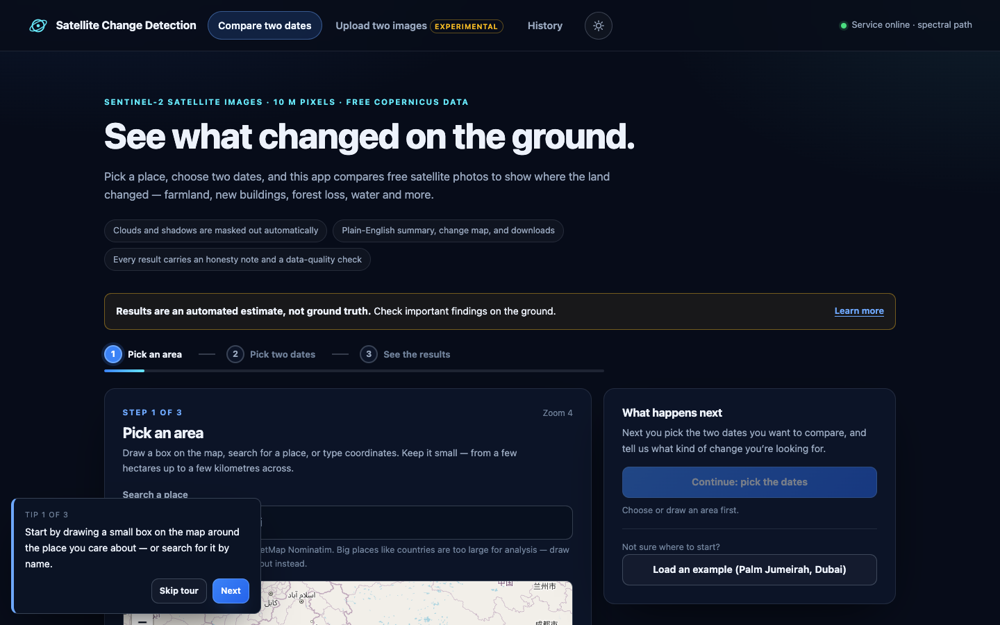
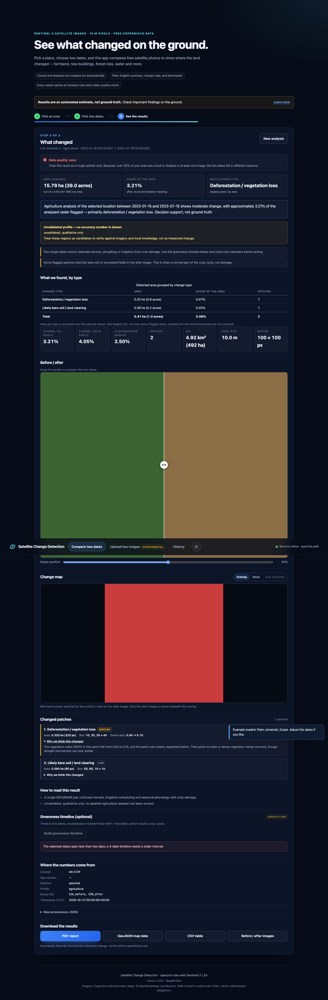
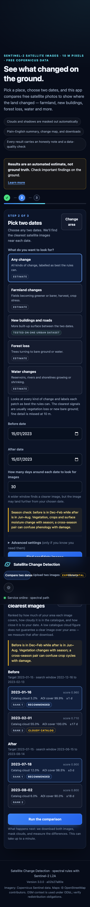

# Satellite Change Detection

A local web app that compares two satellite images of the same place and shows
where the land changed. It uses free Copernicus Sentinel-2 imagery (10 m
pixels), a three-step wizard, plain-English results and a downloadable PDF
report. The analysis is an **automated estimate, not ground truth**.



## Who it is for

- People who need a quick, low-cost pointer to where change may have happened:
  planners, journalists, students, farm advisors, conservation groups.
- Researchers who want a transparent spectral baseline, the saved benchmark
  files and a reproducible local demo.

It is **not** a cadastral record, a compliance tool or a land-cover product.
Every flagged patch needs a human check against imagery or local knowledge.

## What it does

- **Compare two dates** (default): pick an area on a map, choose two dates and
  a change type. The app finds the clearest Sentinel-2 scenes near each date,
  masks clouds and shadows, applies transparent spectral rules and reports
  patches, areas and a data-quality badge.
- **Upload two images** (experimental): runs the CNN change detector on a pair
  of PNG/JPEG images. This needs `model.onnx`; without it the page says so and
  the live path still works.
- **History**: stored analyses can be reopened, exported and re-rendered as a
  PDF without re-running the analysis.

| Results dashboard | Mobile |
|---|---|
|  |  |

These screenshots come from the Playwright browser tests with Copernicus routes
mocked. They show the interface and its wiring, not a live satellite analysis.

## Quick start (under 5 minutes once dependencies are installed)

Requires Python 3.10+.

```bash
cd satellite-change-detection
python3 -m venv venv
source venv/bin/activate
python -m pip install -r requirements-dev.txt

cp .env.example .env          # then fill in the two Copernicus values
python -m uvicorn app:app --host 127.0.0.1 --port 8000
```

Open <http://127.0.0.1:8000>.

The first `pip install` downloads packages and can take longer than five
minutes on a slow connection; the start-up itself is seconds.

### Copernicus credentials (needed for live analysis)

1. Create a free account at <https://dataspace.copernicus.eu/>.
2. In the dashboard, create an OAuth client (client credentials).
3. Put the values in `.env`:

   ```bash
   COPERNICUS_CLIENT_ID=...
   COPERNICUS_CLIENT_SECRET=...
   ```

Credentials are read from the environment only. They are never sent to the
browser, printed or logged (logs redact them). Do not commit `.env`.

Without credentials the app still starts, `/health` and the upload tab work,
and live analysis fails with a plain message telling you what is missing.

The **Load an example (Palm Jumeirah, Dubai)** button fills a demo area and
dates. It still needs credentials and an internet connection to download
imagery; it is not an offline result.

## Use it in the browser

1. **Pick an area** — search for a place, draw a box, use the current map view,
   or type a bounding box. Areas from about 1 ha up to `MAX_AOI_KM` (10 km) per
   side are supported.
2. **Pick two dates** — choose a before and after date and what you are looking
   for. A ±30-day search window (configurable) finds the clearest scenes.
   Advanced settings are hidden unless expanded.
3. **See the results** — before/after slider, change map, class table, plain
   summary, per-patch explanations, data-quality badge and downloads.

The results page always shows the honesty note, the scene dates and IDs, the
cloud/shadow share, and where each number comes from.

### Analysis profiles and evidence status

| Choice in the app | Underlying rules | Evidence status |
|---|---|---|
| Any change | NDVI decrease or NDBI increase | **Estimate** — mixed profile, no labelled evaluation |
| Farmland changes | NDVI/NDMI change, greening and browning split | **Estimate** — no labelled agriculture evaluation |
| New buildings and roads | NDBI, bare-soil index, NDVI-loss cue | **Tested on one urban dataset** — OSCD urban change only, pooled F1 0.118; the extra cues and MMU are not separately ablated |
| Forest loss | NBR/NDVI drop on previously vegetated pixels | **Estimate** — no labelled forest-loss evaluation |
| Water changes | NDVI/NDMI water ceilings; NDWI is not available because the green band is not fetched | **Estimate** — no labelled water evaluation |
| Roads / infrastructure | Context near mapped OSM roads only | **Estimate** — no road detection is claimed; roads under ~20 m are mostly sub-pixel |

Threshold provenance is shown in the app and the PDF. New thresholds added for
this UI (water ceilings, the greening threshold) are marked "chosen by
developer, untested"; the pre-existing thresholds are unchanged.

## Reports, exports and history

The **Download** panel offers:

- **PDF report** — one-page plain summary, data-quality badge and reasons,
  before/after images, change map, legend, per-type areas, settings in plain
  words, credits, limitations and provenance (app version, commit, timestamp).
- **GeoJSON map data** and **CSV table** — per-patch geometry and areas; the
  CSV also carries the same class summary shown on screen.
- **Before / after images** — PNG downloads.

`GET /history/{id}/report` renders the stored PDF without re-posting a large
result. On-screen numbers, CSV and PDF are produced from one class table, and
tests check they agree.

All exports are estimates. The GeoJSON/CSV formats are unchanged from earlier
releases; report-only and class-summary fields are additive.

## Tests

```bash
./venv/bin/python -m pytest -q
```

Last full run in this checkout: **193 passed, 3 skipped, 1 warning** (about 45 s; well under 5 minutes).
The three skips are environment gaps, not failures:

| Skip | Reason |
|---|---|
| `tests/test_oscd_label.py` | `rasterio` is benchmark-only and not installed in the app venv |
| `tests/test_finetune_cnn.py` | `torch` is not installed locally |
| `tests/test_regression_and_api.py` | dataset sample `dataset/test/A/test_100_0_0.png` is absent |

The browser tests run against system Chrome through Playwright and are skipped
when either is missing. Backend tests replace Copernicus calls with in-memory
fakes, so they never authenticate or download imagery; the browser tests mock
the Copernicus routes but may still load map assets from the CDN and tile
providers. The OSCD test split, test labels and model files are not modified or
re-scored by this suite.

## How it works

- **Backend**: FastAPI serves the static page and a small JSON API. Per-request
  limits, a token-redacting access log, security headers and an in-process
  per-path rate limit wrap every route.
- **Live pipeline**: Copernicus catalog search → scene ranking → Sentinel Hub
  Process API (one Evalscript returns RGB, NDVI/NDBI/SCL and NBR/NDMI/BSI) →
  SCL cloud/shadow mask → profile rules → minimum mapping unit → patch
  reasoning. Transient upstream failures are retried with backoff; downloaded
  scenes are kept in a bounded in-memory cache.
- **Profiles**: declarative threshold sets in `profiles/`, shared by the app,
  exports and the report.
- **History**: SQLite (`ANALYSIS_DB_PATH`). No authentication is built in;
  protect any shared deployment with an authenticated proxy.
- **Model (optional)**: the upload tab uses an ONNX Siamese U-Net. The live
  Sentinel-2 path does not use it.

Key routes: `GET /config /health /profiles /history /history/{id}`,
`POST /scenes /fetch-and-predict /timeline /predict /predict-learned
/report /export/{fmt}`, `GET /history/{id}/report`,
`GET /history/{id}/export/{fmt}`. See `/docs` (FastAPI) for schemas.

## Research evidence (logged files, not re-run here)

The repository also contains the saved results behind the paper. They are
reported as measured, with their limitations.

### Controlled-resolution LEVIR-CD result

One checkpoint, 2,048 LEVIR-CD test pairs, controlled blur/resampling only:

| Resolution | Precision | Recall | F1 | IoU |
|---|---:|---:|---:|---:|
| 0.5 m | 88.82% | 85.36% | 87.06% | 77.08% |
| 2 m | 90.78% | 2.26% | 4.41% | — |
| 8 m | 99.59% | 1.32% | 2.61% | — |
| 10 m | 99.47% | 1.32% | 2.61% | — |

Source: `degradation_results.csv`. This is a simulation, not a Sentinel-2
sensor simulation; the paper does not make a causal claim about resolution.

### OSCD v2 (urban change only)

| Method | True change | Predicted change | Score |
|---|---:|---:|---:|
| Hardcoded rule | 5.17% | 2.24% | F1 0.0782 |
| Percentile rule | 5.17% | 1.66% | F1 0.1176 |
| Otsu | 5.17% | 67.35% | OA 0.3439 |
| CNN joint-percentile | 5.17% | 0.01% | F1 0.0007 |

The official test split had already been scored in earlier work; v2 is not an
independent test. The benchmark has no SCL layer, so cloud masking is not
measured there. Full per-city tables and caveats:
[`benchmarks/results/oscd_results_v2.md`](benchmarks/results/oscd_results_v2.md).

A train-only leave-one-city-out check (no test city read) gave pooled F1 0.0976
for the hardcoded rule and 0.1469 for the percentile rule:
[`benchmarks/results/oscd_loco_thresholds.json`](benchmarks/results/oscd_loco_thresholds.json).

The paper and its audits are in [`docs/paper/`](docs/paper/). The learned pixel
classifier and auto-improvement notebooks remain experimental and unrun; no
results from them are claimed.

## Deployment

`DEPLOY.md` covers Docker, Render and Cloud Run. The image contains no model
weights and no credentials; mount `model.onnx` read-only if you need the upload
path. Docker was not available on the machine where this release was verified,
so the image build itself is checked by inspection only (stated again in the
final report).

## Documentation

- [`docs/USER_GUIDE.md`](docs/USER_GUIDE.md) — step-by-step guide for non-experts
- [`docs/LIMITATIONS.md`](docs/LIMITATIONS.md) — resolution, clouds, seasons, validation and privacy limits
- [`docs/DEFINITION_OF_DONE.md`](docs/DEFINITION_OF_DONE.md) — checklist with evidence
- [`docs/FINAL_REPORT.md`](docs/FINAL_REPORT.md) — what was done, test counts, unverified items and merge order
- [`docs/PROJECT_AUDIT.md`](docs/PROJECT_AUDIT.md) — the pre-change audit

## Credits and licences

- Sentinel-2 imagery: Copernicus Data Space Ecosystem. Follow its attribution
  and redistribution terms.
- Map tiles and place search: OpenStreetMap contributors (ODbL); Nominatim.
- OSCD labels: CC BY-NC-SA terms in the dataset used here; a licence review is
  needed before commercial use or redistribution.
- Model weights and benchmark data are not committed to this repository.

Until independent, stratified ground truth exists for each change type, treat
every region as a **candidate to verify, not a finding**.
